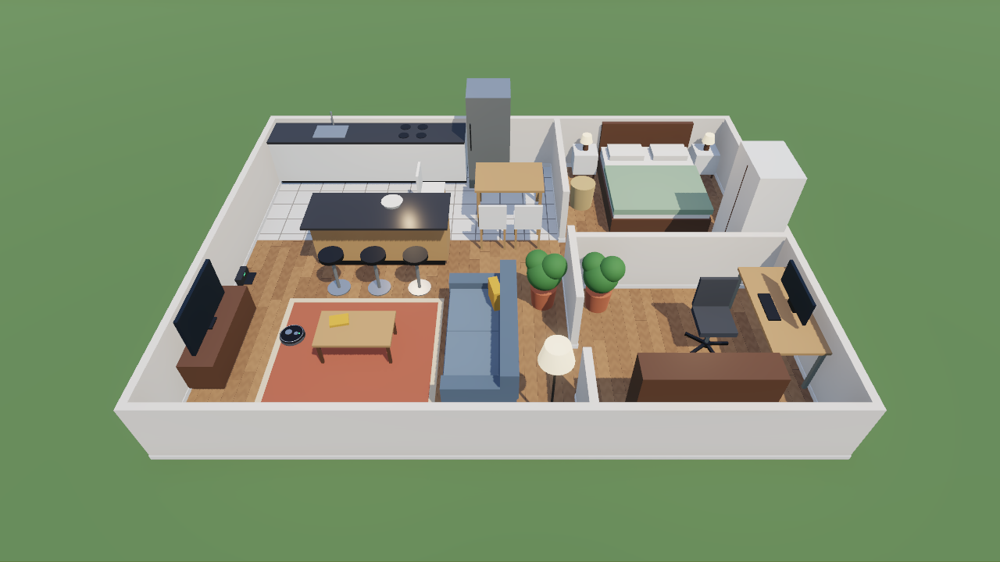
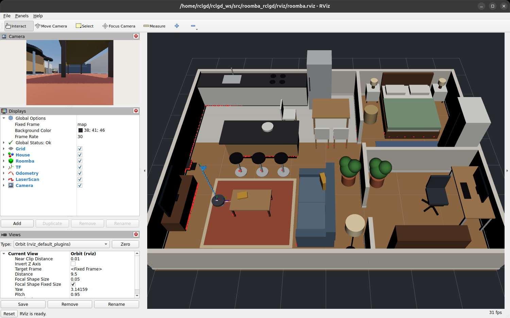

.. role:: core
   :class: core

.. role:: stretch
   :class: stretch

Roomba in a House: an rclgd workshop
====================================

In this 90-minute workshop you turn a Godot game into a ROS 2 robot simulator. You start from
a furnished flat and a vacuum robot that can only move under Godot physics. Step by step, you
connect the robot to ROS 2 with `rclgd <https://rclgd.readthedocs.io>`_, until it does
everything a real robot base does:

* drives from ``/cmd_vel`` (keyboard teleop or your own nodes)
* publishes ``/odom`` and a proper TF tree (``map → odom → base_link → sensors``)
* streams a 2D lidar, an IMU and a front camera
* reports its bumper and draws itself and the whole house in RViz
* offers ``dock`` and ``reset_odometry`` services, takes live parameters and runs a
  ``rotate_absolute`` action

Who this is for
---------------

You already know ROS 2: topics, services, actions, parameters, TF and RViz. You don't need to
know Godot. The tutorial covers the parts that are new: how a Godot project becomes a ROS 2
package, where ROS code goes in a scene, how rclgd's classes map onto ``rclcpp`` concepts, and
the few Godot-specific details to watch for (threads and coordinate frames).

What's in the repository
------------------------

``src/roomba_rclgd_starter``
   **Your starting point.** It has the house, the robot body with its physics, a camera and a
   HUD, the rclgd and rclgd-sensors addons, an RViz config, and no ROS code at all.

``src/roomba_rclgd``
   **The finished result.** It's the same project with every step of this tutorial applied.
   Use it to peek when you're stuck, or run it to see where you're heading.

``docs/``
   This tutorial.

Agenda
------

.. list-table::
   :header-rows: 1
   :widths: 10 50 25 15

   * - Time
     - Step
     - rclgd features
     - Track
   * - 0:00
     - Intro and demo of the finished robot
     -
     -
   * - 0:10
     - :doc:`tutorial/00_setup` (do this before the workshop if you can)
     - ``ros2 rclgd``
     - :core:`core`
   * - 0:15
     - :doc:`tutorial/01_tour`
     - Packages, autoload, typed messages
     - :core:`core`
   * - 0:25
     - :doc:`tutorial/02_cmd_vel`
     - ``RosNode``, subscriptions
     - :core:`core`
   * - 0:35
     - :doc:`tutorial/03_odom_tf`
     - Publishers, ``now()``, TF, axes
     - :core:`core`
   * - 0:50
     - :doc:`tutorial/04_sensors`
     - rclgd-sensors, sensor QoS
     - :core:`core`
   * - 1:00
     - :doc:`tutorial/05_rviz`
     - Timers, signals, latched QoS
     - :core:`core`
   * - 1:10
     - :doc:`tutorial/06_services_params`
     - Services, threading, parameters
     - :core:`core`
   * - 1:20
     - :doc:`tutorial/07_action`
     - Action servers with ``await``
     - :stretch:`stretch`
   * - 1:25
     - :doc:`tutorial/08_next_steps`
     - Close the loop from Python
     -

Each step follows the same pattern: what you'll add, the code, why it works that way in
rclgd, and a **Check it** section with ``ros2`` commands that prove it works before you move on.

.. toctree::
   :maxdepth: 2
   :caption: Workshop
   :numbered:

   tutorial/00_setup
   tutorial/01_tour
   tutorial/02_cmd_vel
   tutorial/03_odom_tf
   tutorial/04_sensors
   tutorial/05_rviz
   tutorial/06_services_params
   tutorial/07_action
   tutorial/08_next_steps
