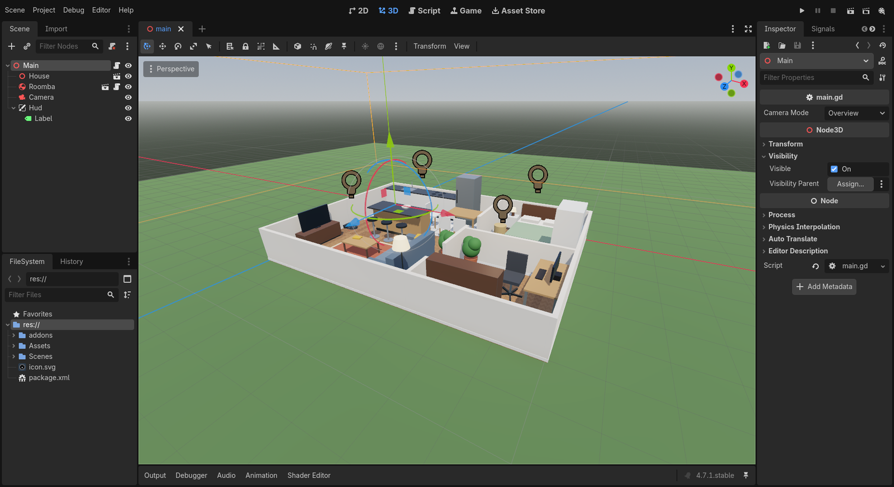

Setup
=====

*About 5 minutes if you did the download beforehand.*

Everything runs in the workshop container: Ubuntu 24.04, ROS 2 Jazzy, ``ros-jazzy-rclgd``
(which ships its own Godot 4.7 build) and the GPU drivers. The host needs Docker, an X11 or
XWayland display and, ideally, VS Code with the Dev Containers extension.

Start the container
-------------------

**VS Code (recommended):** open the repository folder and choose
*Dev Containers: Reopen in Container*. VS Code builds the image from ``docker/Dockerfile`` and
opens a terminal inside it.

**Plain Docker:**

.. code-block:: bash

   xhost +local:docker                 # let the container open windows on your display
   cd docker
   docker compose up -d --build
   docker exec -it rclgd_ws zsh

The repository is mounted at ``~/rclgd_ws`` inside the container.

.. important::

   The container uses the host network, and everyone in the room is on the same Wi-Fi. If you
   don't isolate your graph, you'll be driving your neighbour's Roomba. Keep DDS discovery on
   your own machine:

   .. code-block:: bash

      echo 'export ROS_AUTOMATIC_DISCOVERY_RANGE=LOCALHOST' >> ~/.zshrc
      source ~/.zshrc

Check the rclgd install
-----------------------

rclgd ships a ``ros2 rclgd`` command. ``doctor`` checks the whole chain: the ROS environment,
the extension library, the Godot binary and its version pin.

.. code-block:: console

   $ ros2 rclgd doctor
   ✓ ROS_DISTRO=jazzy, default rmw
   ✓ rclgd sourced from /opt/ros/jazzy
   ✓ extension library /opt/ros/jazzy/lib/rclgd/librclgd.so
   ✓ godot launcher installed (ros2 run rclgd godot)
   ✓ version pin: Godot 4.7.1
   ✓ godot 4.7.1.stable.official.a13da4feb at /opt/ros/jazzy/lib/rclgd/godot-bin
   all checks passed

Build the workspace
-------------------

Godot projects are regular colcon packages, so they build like any other package:

.. code-block:: bash

   cd ~/rclgd_ws
   colcon build --packages-select roomba_rclgd_starter roomba_rclgd
   source install/setup.zsh

``ros2 rclgd list`` now shows both packages, each with its install prefix and source folder.

See where you're heading
------------------------

Run the finished robot once, and give it something to do from a second terminal:

.. code-block:: bash

   ros2 run roomba_rclgd roomba_rclgd

.. code-block:: bash

   python3 ~/rclgd_ws/src/roomba_rclgd/scripts/bump_and_turn.py

Press :kbd:`C` in the Godot window to cycle the camera between *Overview*, *Top-down* and
*Follow*. Close the window when you've seen enough.

Open the starter in the editor
------------------------------

.. code-block:: bash

   ros2 rclgd editor roomba_rclgd_starter

``ros2 rclgd editor`` opens the package's **source** project (``src/roomba_rclgd_starter``),
never the installed copy, from a shell where ``librclgd.so`` resolves. Press :kbd:`F5` (or the
▶ button at the top right) to run the project straight from the editor.

.. tip::

   **Edit, then F5.** Throughout the workshop, run the project from the editor. ``ros2 run
   roomba_rclgd_starter roomba_rclgd_starter`` runs the copy installed by ``colcon build``, so
   it only picks up your changes after you rebuild.

   Either way, ROS arguments work as usual. From the editor, set them under *Project → Project
   Settings → Editor → Run → Main Run Args* (``-- --ros-args -p ...``). From the command line:

   .. code-block:: bash

      ros2 run roomba_rclgd_starter roomba_rclgd_starter --ros-args -p max_linear_speed:=0.2
