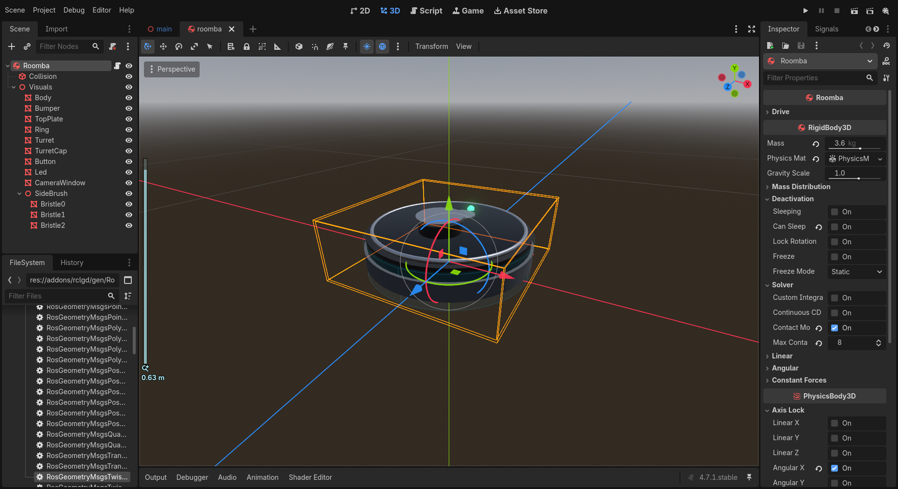
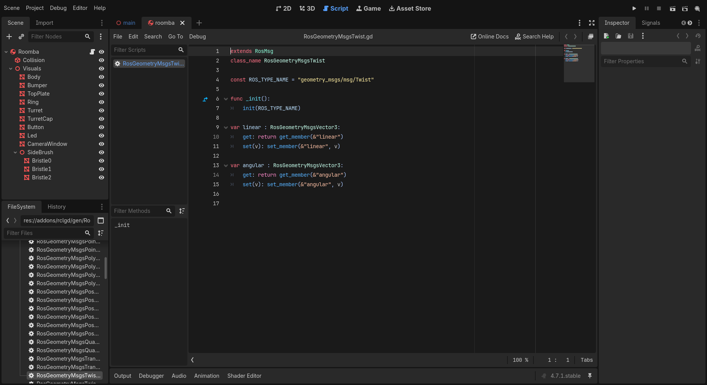

A tour of the starter
=====================

*10 minutes. No code yet: this is where you learn your way around.*

The package is a Godot project
------------------------------

.. code-block:: text

   src/roomba_rclgd_starter/
   ├── package.xml          ← a normal ROS 2 manifest, build_type "rclgd"
   ├── project.godot        ← Godot project settings (main scene, physics, autoloads, plugins)
   ├── Scenes/
   │   ├── main.tscn/.gd    ← house + robot + camera + HUD
   │   ├── house/house.tscn ← the flat: floors, walls, furniture, dock
   │   └── roomba/          ← the robot: roomba.tscn + roomba.gd   ← you work here
   ├── Assets/shaders/      ← procedural wood and tile floors
   ├── addons/
   │   ├── rclgd/           ← the ROS 2 bridge: editor plugin, autoload, generated messages
   │   └── rclgd-sensors/   ← lidar, IMU, camera, GPS … nodes that publish to ROS
   └── rviz/roomba.rviz     ← ready-made RViz config (the .gdignore hides it from Godot)

The manifest is what makes this a ROS package:

.. code-block:: xml

   <buildtool_depend>rclgd</buildtool_depend>
   <exec_depend>geometry_msgs</exec_depend>
   <exec_depend>nav_msgs</exec_depend>
   <exec_depend>sensor_msgs</exec_depend>
   <exec_depend>std_msgs</exec_depend>
   <exec_depend>std_srvs</exec_depend>
   <exec_depend>visualization_msgs</exec_depend>
   <exec_depend>turtlesim</exec_depend>

   <export>
     <build_type>rclgd</build_type>
   </export>

``colcon build`` copies the project to ``install/<pkg>/share/<pkg>``, imports its assets, and
installs a ``lib/<pkg>/<pkg>`` launcher. That launcher is what ``ros2 run`` starts: it runs
the Godot binary shipped with rclgd on that project and passes ``--ros-args`` through. A fresh
package like this one comes from ``ros2 rclgd create my_pkg --dependencies geometry_msgs ...``.

The ``exec_depend`` list does a second job: it decides which **typed message classes** you get
in GDScript (see :ref:`below <tutorial/01_tour:Typed messages>`).

Scenes and nodes
----------------

A Godot scene (``.tscn``) is a tree of nodes, and any node can be the root of a reusable scene.
Open ``Scenes/main.tscn`` (it's open by default) and look at the *Scene* dock on the left:

``Main`` (Node3D, ``main.gd``)
   Switches cameras on :kbd:`C` and updates the HUD.

``House`` (an instance of ``house/house.tscn``)
   Plain nodes all the way down. Each piece of furniture is a ``StaticBody3D`` holding
   ``MeshInstance3D`` (what you see) and ``CollisionShape3D`` (what the robot and the lidar hit)
   children. Move a sofa in the editor and the robot, the lidar and RViz all see the change.
   ``DockPose`` is a ``Marker3D`` where the charging dock is.

``Roomba`` (an instance of ``roomba/roomba.tscn``)
   The robot, sitting on its dock.

``Camera`` and ``Hud``
   The view and the text overlay.

Double-click ``roomba/roomba.tscn`` in the *FileSystem* dock to open the robot on its own:

The robot is a physics body
---------------------------

``Roomba`` is a ``RigidBody3D``. It has a real mass, collides with the furniture, and gravity
keeps it on the floor. Its rotation about the X and Z axes is locked, so it can't tip over.
``roomba.gd`` turns it into a differential-drive base with a small API:

.. code-block:: gdscript

   signal bumper_changed(pressed: bool)   # the front bumper was pressed or released

   func drive(linear: float, angular: float) -> void   # m/s forward, rad/s counterclockwise
   func stop() -> void
   func teleport(target: Transform3D) -> void          # jump to a pose, stopped

   var linear_speed: float     # current speeds after acceleration
   var angular_speed: float
   var bumper_pressed: bool

``drive()`` stores the targets. Every physics step, ``_integrate_forces()`` ramps the wheel
speeds toward them and sets the body's velocity along its heading. While doing that, it checks
the contacts on the front half of the body for the bumper. All of this is plain Godot.

.. note::

   Why a ``RigidBody3D`` and not a kinematic ``CharacterBody3D``? The rclgd-sensors IMU
   differentiates the velocity of the ``RigidBody3D`` it's mounted on, and a dynamic body
   gives you real pushes and contacts, which is what makes the bumper work.

The ROS autoload
----------------

Open *Project → Project Settings → Globals → Autoload*. You'll see ``ROS`` →
``res://addons/rclgd/ros_init.gd``. An autoload is a singleton that Godot creates before the
first scene loads. Here it does the equivalent of ``rclcpp::init()``:

* it collects the command-line arguments after Godot's ``--`` separator, which is where the
  launcher puts ``--ros-args ...``;
* it adds every Project Setting under ``ros/parameters/`` as a ``-p name:=value`` override
  (you'll use this in :doc:`06_services_params`);
* it calls ``rclgd.init(args)`` and, when the game closes, ``rclgd.shutdown()``.

So your scripts never initialize ROS. They create nodes, and by the time any ``_ready()``
runs, the context is up. This is also where the ``/rclgd_<pid>`` node in ``ros2 node list``
comes from: it's the context's own node, not one of yours.

Typed messages
--------------

When the editor opens, the rclgd plugin generates a GDScript class for every message in the
packages listed in ``package.xml``, under ``addons/rclgd/gen/``. Each class is named after
the message type, with ``Ros`` in front:

.. list-table::
   :header-rows: 1

   * - ROS type
     - GDScript class
   * - ``geometry_msgs/msg/Twist``
     - ``RosGeometryMsgsTwist``
   * - ``nav_msgs/msg/Odometry``
     - ``RosNavMsgsOdometry``
   * - ``visualization_msgs/msg/Marker``
     - ``RosVisualizationMsgsMarker``

They give you autocompletion and static types (``var odom := RosNavMsgsOdometry.new()``). The
fields are the message's fields, so ``odom.pose.pose.position.x`` works as you'd expect.
Without them, the untyped API does the same: ``RosMsg.from_type("nav_msgs/msg/Odometry")``.

If you add a dependency to ``package.xml`` later, run *Project → Tools → Regenerate ROS2
Types*. Custom ``.msg`` files from your own packages work the same way, with no recompiling:
rclgd introspects them at runtime.

Godot axes vs ROS axes
----------------------

This is the one Godot detail that matters for every step from here on. Both engines use
right-handed axes, but they point them differently:

.. list-table::
   :header-rows: 1

   * - Direction
     - Godot
     - ROS (REP 103)
   * - Forward
     - −Z
     - +X
   * - Left
     - −X
     - +Y
   * - Up
     - +Y
     - +Z

rclgd's TF classes convert automatically. When you fill a message by hand, use
``rclgd.godot_to_ros_vector()`` and ``rclgd.godot_to_ros_quat()`` (and the ``ros_to_godot_*``
versions for the other direction). rclgd's docs explain the mapping in detail:
`Transforms & Coordinate Systems <https://rclgd.readthedocs.io/en/latest/concepts/transforms.html>`_.

Check it
--------

Press :kbd:`F5`. The robot sits on its dock and nothing moves: it has no way to receive a
command yet.

.. code-block:: console

   $ ros2 node list
   /rclgd_12345

Only the context node is there. Time to give the robot a node of its own.
