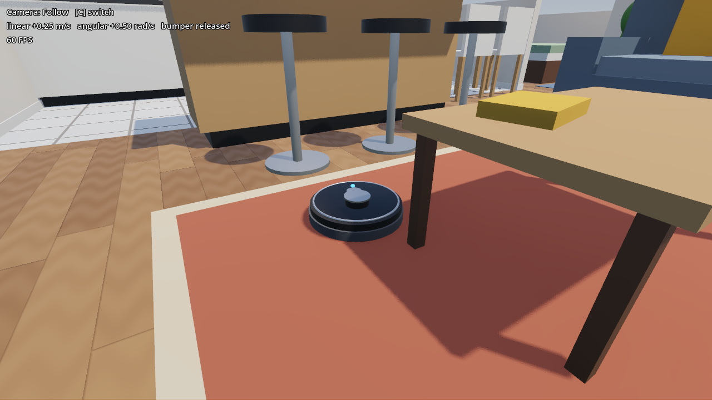

Drive it from /cmd_vel
======================

*10 minutes.* **You add:** the robot's ``RosNode`` and a ``geometry_msgs/Twist`` subscription.

All the code from here on goes into ``Scenes/roomba/roomba.gd``. Open it from the *FileSystem*
dock, or click the scroll icon next to the ``Roomba`` node.

Add the node and the subscription
---------------------------------

First, add one export and a few member variables. Put them below the existing ``@onready``
lines:

.. code-block:: gdscript

   @export_group("ROS 2")
   ## Stop when no /cmd_vel arrives for this long (s), like most real robot bases
   @export var cmd_vel_timeout: float = 0.5

.. code-block:: gdscript

   # --- ROS 2 ---
   var _node: RosNode
   # Step 2: velocity commands
   var _cmd_vel_sub: RosSubscriber
   var _last_cmd_time: float = -INF

Then create the node when the robot enters the scene. ``_ready()`` is Godot's "constructor
done, I'm in the tree" callback. The starter doesn't have one yet:

.. code-block:: gdscript

   func _ready() -> void:
       # Step 2: one RosNode per robot. The ROS autoload already initialized rclgd.
       _node = RosNode.new()
       _node.init("roomba")
       _cmd_vel_sub = _node.create_subscription("/cmd_vel", "geometry_msgs/msg/Twist", _on_cmd_vel)

Then add the callback, plus a watchdog that stops the robot when commands stop arriving:

.. code-block:: gdscript

   ## Topic callbacks run on Godot's main thread, so the scene can be touched directly
   func _on_cmd_vel(msg: RosMsg) -> void:
       _last_cmd_time = _now_s()
       drive(msg.linear.x, msg.angular.z)

   func _now_s() -> float:
       return Time.get_ticks_msec() / 1000.0

   func _physics_process(_delta: float) -> void:
       if _now_s() - _last_cmd_time > cmd_vel_timeout:
           stop()

That's the whole bridge: ROS ``linear.x`` and ``angular.z`` go straight into the Godot API.
The robot's ``drive()`` already uses ROS conventions (forward positive, counterclockwise
positive), so nothing needs converting.

How it works
------------

``RosNode``
   One ``rclcpp::Node``. ``init(name, namespace = "")`` puts it on the graph. You can have as
   many as you like in one game: in :doc:`04_sensors` every sensor brings its own. rclgd runs
   them all on one executor in a background thread.

``create_subscription(topic, type, callback, qos = null)``
   The type is a plain string. The callback is any ``Callable``: a method like
   ``_on_cmd_vel``, or an inline ``func(msg): ...`` lambda.

**Keep the references.** Every rclgd object (node, publisher, subscriber, timer, service…)
unregisters from the ROS graph when it's freed. A subscription stored only in a local variable
disappears at the end of ``_ready()``. That's why they all live in member variables.

**Threads.** Topic, timer and action callbacks are queued from the executor thread and run on
Godot's **main thread**, between frames. That's why ``_on_cmd_vel`` can call ``drive()``, or
anything else on the scene, without locks. Services are the one exception (see
:doc:`06_services_params`).

**Messages.** The callback receives a ``RosMsg``, a dynamic view of the message, and you read
its fields by name. Nested messages (``msg.linear``) are themselves ``RosMsg`` objects, so
``msg.linear.x`` reads straight through.

Check it
--------

Press :kbd:`F5`, then from a terminal:

.. code-block:: console

   $ ros2 node list
   /rclgd_12345
   /roomba
   $ ros2 topic info /cmd_vel
   Type: geometry_msgs/msg/Twist
   Publisher count: 0
   Subscription count: 1

Drive with the keyboard. **Hold** a key down: a single tap moves the robot for half a second,
then the watchdog stops it.

.. code-block:: bash

   ros2 run teleop_twist_keyboard teleop_twist_keyboard

Or send a steady command (forward while turning left, so it drives in a circle):

.. code-block:: bash

   ros2 topic pub -r 10 /cmd_vel geometry_msgs/msg/Twist "{linear: {x: 0.3}, angular: {z: 0.8}}"

Press :kbd:`C` twice for the *Follow* camera. Drive into a chair leg and watch the HUD's
bumper, and the LED, turn red.

