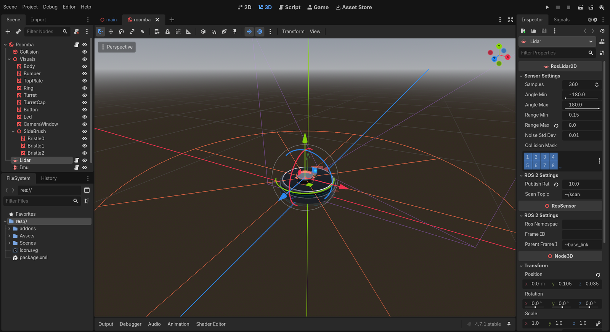

Sensors
=======

*10 minutes.* **You add:** a 2D lidar, an IMU and a front camera. You won't write any code:
they're nodes from the ``rclgd-sensors`` addon that you drop into the robot scene.

The addon is already in ``addons/rclgd-sensors`` and enabled under *Project → Project Settings
→ Plugins*. It adds these node types: ``RosLidar2D``, ``RosLidar`` (3D, GPU), ``RosCamera``,
``RosFisheyeCamera``, ``RosImu`` and ``RosGps``.

Add the sensors
---------------

Open ``Scenes/roomba/roomba.tscn``. For each sensor: select the **root** ``Roomba`` node,
press :kbd:`Ctrl+A` (or the **+** button), search for the type, and create it. Then rename it,
set its position under *Transform* in the inspector, and change the properties in the table.

.. list-table::
   :header-rows: 1
   :widths: 14 16 26 44

   * - Name
     - Type
     - Position (x, y, z)
     - Properties
   * - ``Lidar``
     - ``RosLidar2D``
     - ``0, 0.105, 0.035``
     - *Range Max* ``8``, *Publish Rate* ``10``
   * - ``Imu``
     - ``RosImu``
     - ``0, 0.05, 0``
     - *Publish Rate* ``30``
   * - ``Camera``
     - ``RosCamera``
     - ``0, 0.055, -0.172``
     - *Fov* ``90``, *Near* ``0.02``

The lidar sits in the turret on top, and the camera looks out of the dark window at the front
(remember: forward is −Z in Godot). Each sensor draws a gizmo in the 3D view, so you can see
the lidar's scan plane and the camera's frustum.

Save with :kbd:`Ctrl+S` and press :kbd:`F5`.

How it works
------------

**Every sensor is its own ROS node.** A sensor creates a ``RosNode`` named after the Godot node
in snake_case, and publishes on private topics. So ``Lidar`` becomes the node ``/lidar``
publishing ``/lidar/scan``, ``Imu`` gives ``/imu/data``, and ``Camera`` gives
``/camera/image_raw`` and ``/camera/camera_info``. Rename a node and its topics follow.

**Mounting is TF.** On startup, each sensor publishes a static transform from its
``parent_frame_id`` (default ``~base_link``) to its own frame (default: its name), using its
transform **relative to its parent node**. That's why the sensors must be **direct children**
of ``Roomba``, whose origin is ``base_link``: if you nested the lidar under a mount node,
its TF would be relative to the mount, not the robot. The camera also publishes
``camera → camera_optical`` (z forward, x right), which is what image consumers expect.

**The** ``~`` **prefix and namespaces.** ``~base_link`` means "``base_link`` inside this
sensor's *ROS Namespace*". With the namespace empty, that's just ``base_link``. Set the
namespace to ``roomba2`` and the sensor publishes ``/roomba2/lidar/scan`` in the frame
``roomba2/lidar``, mounted on ``roomba2/base_link``. That's the building block for running
several robots in one simulation (the robot's own node and frames would need the same prefix).

**Sensor QoS.** Sensors publish with the sensor-data profile, like ``rclcpp::SensorDataQoS``:
best effort, keep last 5, volatile. A *reliable* subscriber doesn't match a best-effort
publisher, so ``ros2 topic echo`` works (it adapts its QoS), but in RViz you must set the
display's *Reliability Policy* to *Best Effort*. The provided ``roomba.rviz`` already does.

**Timing.** The 2D lidar casts its rays with Godot's physics engine, spread over the physics
steps of one revolution like a spinning sensor would, and stamps the scan at the first ray. The
IMU differentiates the body's velocity every physics step and adds noise and bias drift; since
it publishes on physics steps (60 Hz here), pick a rate that divides 60 (30, 20…), because 50
would come out as 60. The camera renders a second viewport and publishes from its own thread.

Check it
--------

.. code-block:: console

   $ ros2 node list
   /camera
   /imu
   /lidar
   /rclgd_12345
   /roomba
   $ ros2 topic hz /lidar/scan
   average rate: 10.000
   $ ros2 topic echo /imu/data --field linear_acceleration --once
   x: 0.03
   y: -0.02
   z: 9.81

The IMU reads +9.81 m/s² on z at rest: an accelerometer measures the floor pushing up, in
ROS axes. To see the camera:

.. code-block:: bash

   ros2 run rqt_image_view rqt_image_view /camera/image_raw
