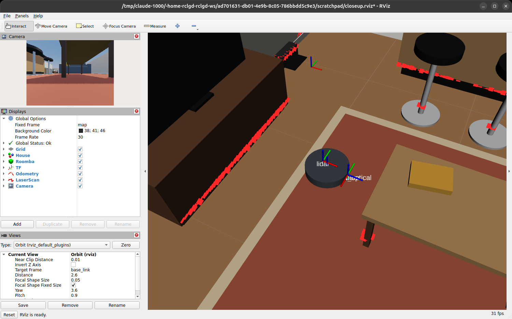

Bumper, markers and RViz
========================

*10 minutes.* **You add:** a ``/bumper`` topic driven by a Godot signal and a ROS timer, a
marker that draws the robot, and a ``MarkerArray`` that mirrors the whole house into RViz.

Bumper and robot marker
-----------------------

Members:

.. code-block:: gdscript

   # Step 5: bumper and RViz marker
   var _bumper_pub: RosPublisher
   var _marker_pub: RosPublisher
   var _status_timer: RosTimer
   var _bumper_msg := RosStdMsgsBool.new()
   var _marker_msg := RosVisualizationMsgsMarker.new()

Call ``_setup_status()`` from ``_ready()``, after ``_setup_odometry()``, and add:

.. code-block:: gdscript

   func _setup_status() -> void:
   	_bumper_pub = _node.create_publisher("/bumper", "std_msgs/msg/Bool")
   	_marker_pub = _node.create_publisher("~/marker", "visualization_msgs/msg/Marker")

   	_marker_msg.header.frame_id = "base_link"
   	_marker_msg.ns = "roomba"
   	_marker_msg.type = 3 # CYLINDER
   	_marker_msg.pose.position.z = 0.045
   	_marker_msg.pose.orientation.w = 1.0
   	_marker_msg.scale.x = 0.34
   	_marker_msg.scale.y = 0.34
   	_marker_msg.scale.z = 0.07
   	_marker_msg.color.a = 1.0

   	# Publish on every bumper change (a Godot signal) and at 10 Hz (a ROS timer)
   	bumper_changed.connect(func(_pressed: bool) -> void: _publish_status())
   	_status_timer = _node.create_timer(0.1, _publish_status)

   func _publish_status() -> void:
   	_bumper_msg.data = bumper_pressed
   	_bumper_pub.publish(_bumper_msg)

   	_marker_msg.header.stamp = _node.now()
   	var color := Color(0.9, 0.2, 0.15) if bumper_pressed else Color(0.25, 0.27, 0.3)
   	_marker_msg.color.r = color.r
   	_marker_msg.color.g = color.g
   	_marker_msg.color.b = color.b
   	_marker_pub.publish(_marker_msg)

How it works
^^^^^^^^^^^^

**Signals to topics.** ``bumper_changed`` is a Godot signal, Godot's observer pattern. Connecting
it to a publisher sends a message the moment the bumper changes, so a controller doesn't have to
wait up to 100 ms for the next timer tick. The timer keeps the topic alive at 10 Hz for
latecomers and for ``ros2 topic hz``.

``RosTimer``
   ``create_timer(period_s, callback)`` is a ROS timer on the node's clock, like
   ``rclcpp::create_timer``, so it follows sim time when ``use_sim_time`` is set. That's the
   difference from Godot's own ``Timer`` node, which counts game time. The callback runs on the
   main thread. Keep the returned object: dropping it cancels the timer.

**Private names.** ``~/marker`` expands to ``/roomba/marker``, the same rules as in ``rclcpp``.

**Constants.** Message constants such as ``Marker.CYLINDER`` aren't generated as GDScript
constants, so use the number (and a comment).

The house in RViz
-----------------

Godot already knows the shape of every piece of furniture. ``house_markers.gd`` walks the house
scene, turns every box, cylinder and sphere mesh into a ``Marker`` in the ``map`` frame, and
publishes them once as a ``MarkerArray``. Copy it from the finished project:

.. code-block:: bash

   cp ~/rclgd_ws/src/roomba_rclgd/Scenes/house/house_markers.gd \
      ~/rclgd_ws/src/roomba_rclgd_starter/Scenes/house/

Then open ``Scenes/main.tscn``:

#. Select ``Main``, add a child node of type ``Node`` and name it ``HouseMarkers``.
#. Drag ``Scenes/house/house_markers.gd`` from the *FileSystem* dock onto it.
#. In the inspector, set its **House** property to the ``House`` node (click *Assign…* or drag
   the node onto the field).

.. literalinclude:: ../../src/roomba_rclgd/Scenes/house/house_markers.gd
   :language: gdscript
   :caption: Scenes/house/house_markers.gd
   :start-at: func _ready
   :end-before: func _collect

Two new rclgd details:

``RosQoS``
   Builds a QoS profile: ``set_reliability``, ``set_durability``, ``set_history``,
   ``set_depth``, plus deadline, lifespan and liveliness. ``TRANSIENT_LOCAL`` makes the
   message "latched": the house is published once, and a subscriber that joins later (RViz,
   started after the sim) still receives it, as long as it also asks for transient local.

**Arrays are copies.** Reading ``array.markers`` gives you a copy, so appending to it would be
lost. Build a GDScript ``Array`` and assign it in one go, as above. The same rule applies to
``LaserScan.ranges``, covariance arrays and so on.

The pose conversion is the one you used for odometry, and box sizes swap axes the same way
(ROS ``x, y, z`` ← Godot ``z, x, y``):

.. literalinclude:: ../../src/roomba_rclgd/Scenes/house/house_markers.gd
   :language: gdscript
   :start-at: # Mesh sizes are in Godot axes
   :end-before: else:

Open RViz
---------

.. code-block:: bash

   rviz2 -d ~/rclgd_ws/src/roomba_rclgd_starter/rviz/roomba.rviz

.. image:: ../_static/images/rviz_full.png
   :alt: RViz with the house markers, the robot marker, laser scan, TF frames and camera image
   :class: screenshot
   :width: 100%

The config sets *Fixed Frame* to ``map`` and enables:

.. list-table::
   :header-rows: 1

   * - Display
     - Topic
     - QoS that matters
   * - House (MarkerArray)
     - ``/house/markers``
     - Durability **Transient Local**
   * - Roomba (Marker)
     - ``/roomba/marker``
     -
   * - TF
     - ``/tf``, ``/tf_static``
     -
   * - Odometry
     - ``/odom``
     - keeps the last 60 poses as a trail
   * - LaserScan
     - ``/lidar/scan``
     - Reliability **Best Effort**
   * - Camera (Image)
     - ``/camera/image_raw``
     - Reliability **Best Effort**

Check it
--------

Drive around with teleop. The red scan points should sit exactly on the walls and furniture
legs in RViz, and stay put as the robot turns. If they swing around with the robot, a sensor
is probably not a direct child of ``Roomba`` (see :doc:`04_sensors`).

Push the robot into the sofa: ``/bumper`` turns ``true`` and the robot marker turns red.

.. code-block:: bash

   ros2 topic echo /bumper
