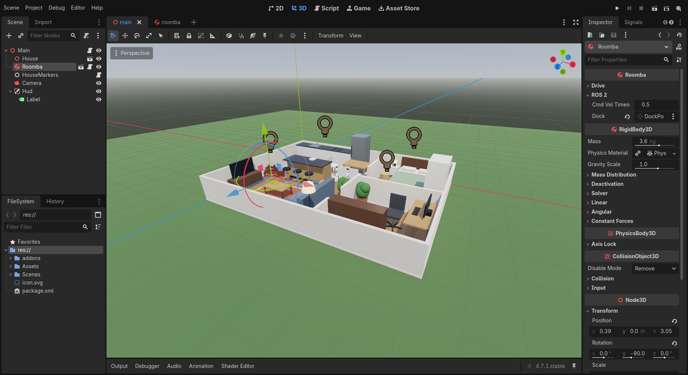

Services and parameters
=======================

*10 minutes.* **You add:** ``~/dock`` (``std_srvs/Trigger``) and ``~/reset_odometry``
(``std_srvs/Empty``) services, and two live parameters, ``max_linear_speed`` and
``max_angular_speed``.

Services
--------

The dock service needs to know where the dock is. Add an export to the ``ROS 2`` group, under
``cmd_vel_timeout``:

.. code-block:: gdscript

   ## Where the ~/dock service sends the robot
   @export var dock: Node3D

Save the script, open ``Scenes/main.tscn``, select ``Roomba`` and, in the inspector, assign
**Dock** → ``House/DockPose``:

Members:

.. code-block:: gdscript

   # Step 6: services
   var _dock_srv: RosService
   var _reset_odom_srv: RosService
   var _dock_pose: Transform3D # Read on the main thread; service callbacks must not touch nodes

Call ``_setup_services()`` from ``_ready()``, and add:

.. code-block:: gdscript

   func _setup_services() -> void:
   	_dock_pose = dock.global_transform if dock else global_transform
   	_dock_srv = _node.create_service("~/dock", "std_srvs/srv/Trigger", _on_dock)
   	_reset_odom_srv = _node.create_service("~/reset_odometry", "std_srvs/srv/Empty", _on_reset_odometry)

   ## Service callbacks run on the ROS executor thread: fill the response here, but defer any
   ## change to the scene to the main thread.
   func _on_dock(_req: RosMsg, res: RosMsg) -> void:
   	teleport.call_deferred(_dock_pose)
   	res.success = true
   	res.message = "Back on the dock"

   func _on_reset_odometry(_req: RosMsg, _res: RosMsg) -> void:
   	_reset_odometry.call_deferred()

The threading rule
^^^^^^^^^^^^^^^^^^

This is the one place where rclgd differs from "everything runs on the main thread". A service
has to answer the client before its callback returns, so rclgd runs service callbacks
**synchronously on the executor thread**. Two consequences:

* **Fill** ``res`` **directly**, then return. That's the response.
* **Don't touch the scene tree.** Reading ``dock.global_transform`` in ``_on_dock`` would fail
  with *"can only be accessed from either the main thread or a thread group"*. Read what you
  need beforehand, on the main thread (``_dock_pose`` in ``_setup_services()``), and use
  ``call_deferred()`` for anything that changes the scene. ``teleport.call_deferred(...)``
  queues the call for the next idle frame on the main thread.

Topic, timer and action callbacks don't have this problem: rclgd already defers them for you.

Parameters
----------

.. code-block:: gdscript

   func _setup_parameters() -> void:
   	# The exported values are the defaults; -p overrides (command line or the ros/parameters
   	# project settings) win, so read them back after declaring.
   	_node.declare_parameter("max_linear_speed", max_linear_speed)
   	_node.declare_parameter("max_angular_speed", max_angular_speed)
   	max_linear_speed = _node.get_parameter("max_linear_speed")
   	max_angular_speed = _node.get_parameter("max_angular_speed")
   	_node.parameter_changed.connect(_on_parameter_changed)

   ## Called for every `ros2 param set` on this node
   func _on_parameter_changed(param_name: String, value: Variant) -> void:
   	match param_name:
   		"max_linear_speed":
   			max_linear_speed = value
   		"max_angular_speed":
   			max_angular_speed = value

Call ``_setup_parameters()`` from ``_ready()``. Parameters are typed from their default: a
``float`` default declares a double parameter, an ``int`` an integer, and arrays
(``PackedFloat64Array``, ``PackedStringArray``…) become array parameters.

``parameter_changed`` is a Godot signal on ``RosNode``, emitted after a ``ros2 param set``
(or any ``SetParameters`` call) is accepted.

Three ways to set a parameter
^^^^^^^^^^^^^^^^^^^^^^^^^^^^^

#. **At runtime:** ``ros2 param set /roomba max_linear_speed 0.1``.
#. **On the command line:** ``ros2 run roomba_rclgd_starter roomba_rclgd_starter --ros-args -p
   max_linear_speed:=0.2``.
#. **In Project Settings**, as a project-wide default. Open *Project → Project Settings*, turn
   on *Advanced Settings*, type ``ros/parameters/max_linear_speed`` in the *Add* field at the
   top, choose type ``float``, and set it to ``0.4``. The ROS autoload passes every
   ``ros/parameters/*`` setting as ``-p name:=value`` (it skips any name you also passed on the
   command line). It ends up in ``project.godot``:

   .. code-block:: ini

      [ros]

      parameters/max_linear_speed=0.4

   These are global ``-p`` overrides, so they reach every node in the game. Nodes that don't
   declare the parameter simply ignore it.

Check it
--------

.. code-block:: console

   $ ros2 service call /roomba/dock std_srvs/srv/Trigger
   response:
   std_srvs.srv.Trigger_Response(success=True, message='Back on the dock')

   $ ros2 service call /roomba/reset_odometry std_srvs/srv/Empty
   $ ros2 topic echo --once /odom --field pose.pose.position
   x: 0.0
   y: 0.0
   z: 0.0

   $ ros2 param get /roomba max_linear_speed
   Double value is: 0.4
   $ ros2 param set /roomba max_linear_speed 0.1
   Set parameter successful

Drive with teleop after the last command. However hard you push, the robot crawls at 0.1 m/s.
Notice that ``reset_odometry`` also moved ``map → odom``: the ``odom`` axes in RViz jump to
the robot.
