Extra: an HMI built in the Godot editor
=======================================

*About 30 minutes, after the workshop or as a take-home.* **You build:** a new package,
``my_roomba_hmi``, with a control panel for the Roomba: the live front camera, four arrows to
drive, a speed slider and a *Dock* button. You build nearly all of it with the mouse in the
editor. The only code is one short script. The finished package is ``src/roomba_hmi``, which
you can run with ``ros2 run roomba_hmi roomba_hmi`` to see where you're heading.

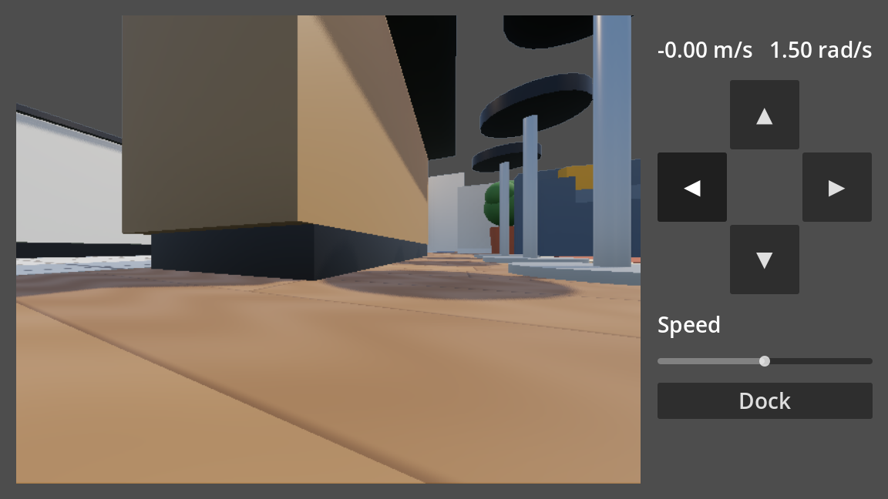

Why Godot for an HMI? Godot's own editor is built with the same UI toolkit you're about to
use, so you get:

* **Layout without pixels.** Containers arrange the widgets for you, and the whole panel scales
  to whatever screen it runs on.
* **Wiring without code.** A button's ``pressed`` signal is connected to your script in a
  dialog.
* **One place for the look.** A single ``Theme`` styles every widget at once.
* **The same rclgd API.** Callbacks run on the main thread, so they can update widgets
  directly, and a service call is a single ``await`` that never freezes the UI.

Create the package
------------------

.. code-block:: bash

   cd ~/rclgd_ws/src
   ros2 rclgd create my_roomba_hmi --renderer gl_compatibility \
       --dependencies geometry_msgs nav_msgs sensor_msgs std_msgs std_srvs
   cd ~/rclgd_ws
   colcon build --packages-select my_roomba_hmi
   source install/setup.zsh
   ros2 rclgd editor my_roomba_hmi

``--dependencies`` lists the message packages the HMI uses, so the editor generates their
typed classes (:doc:`01_tour`). ``gl_compatibility`` is Godot's lightest renderer, plenty for
a 2D panel.

The new package has a demo scene. In the *FileSystem* dock, right-click ``main.tscn`` →
*Delete*. Keep ``main.gd``: you'll reuse it in step 8.

1. The root node
----------------

In the *Scene* dock, click **User Interface**. That creates a ``Control`` that fills the
window.

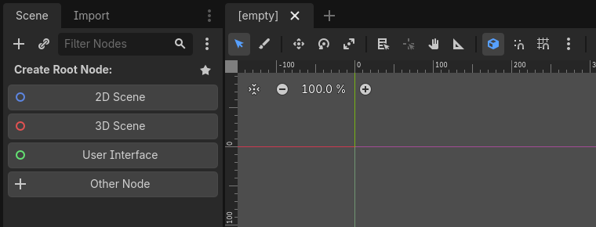

Double-click the new node and rename it to ``HMI``. In the *Inspector*, *Layout → Anchors
Preset* is already **Full Rect**, which keeps the HMI stretched over the whole window.

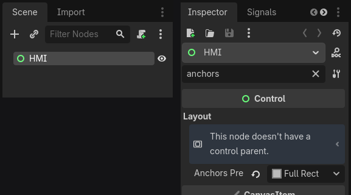

Save with :kbd:`Ctrl+S` as ``main.tscn``. It becomes the main scene again.

.. tip::

   The Inspector has many properties. Type part of a name in its **Filter Properties** box
   (``anchors``, ``columns``, ``minimum``…) to jump straight to it, as in the screenshot above.

2. The layout boxes and the camera
----------------------------------

Everything else goes inside containers. To add a node, select its parent and press
:kbd:`Ctrl+A` (or the **+** at the top of the *Scene* dock), then type the type's name and
press :kbd:`Enter`:

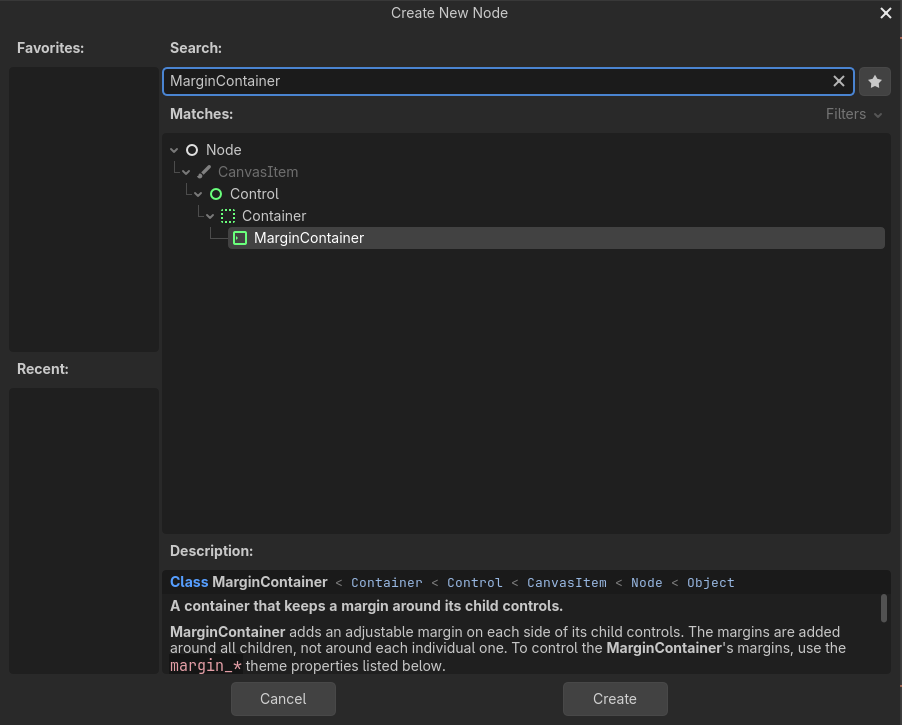

Add these four nodes, and rename each one (double-click it):

.. list-table::
   :header-rows: 1
   :widths: 14 18 18 50

   * - Name
     - Type
     - Parent
     - In the Inspector
   * - ``Margin``
     - ``MarginContainer``
     - ``HMI``
     - *Layout → Anchors Preset*: **Full Rect**. *Theme Overrides → Constants*: tick all
       four *Margin* values and set them to ``20``.
   * - ``Row``
     - ``HBoxContainer``
     - ``Margin``
     - *Theme Overrides → Constants → Separation*: ``20``
   * - ``Camera``
     - ``TextureRect``
     - ``Row``
     - *Expand Mode*: **Ignore Size**. *Stretch Mode*: **Keep Aspect Centered**.
       *Layout → Container Sizing → Horizontal*: tick **Expand**.
   * - ``Column``
     - ``VBoxContainer``
     - ``Row``
     - *Alignment*: **Center**. *Theme Overrides → Constants → Separation*: ``20``

Then add a ``Label`` called ``Status`` inside ``Column``. Set its *Text* to ``Waiting for the
robot…`` and *Horizontal Alignment* to **Center**.

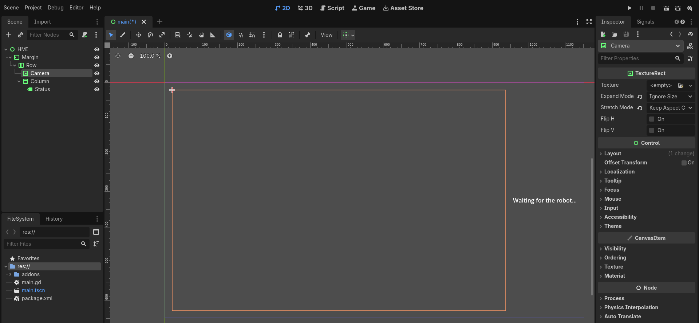

``Row`` places its children side by side. The camera is the only one set to **Expand**, so it
takes all the width the column doesn't need. *Ignore Size* plus *Keep Aspect Centered* let the
image grow and shrink with the window without being distorted. It's empty for now: the
picture arrives from ROS when the HMI runs.

3. The drive pad
----------------

Add a ``GridContainer`` called ``Pad`` inside ``Column``. Set *Columns* to ``3`` and *Layout →
Container Sizing → Horizontal* to **Shrink Center**.

A grid fills its cells left to right, top to bottom. Empty ``Control`` nodes make the gaps
around the arrows. Add these eight children to ``Pad``, in this order. Make the first
``Control`` and the first ``Button``, then duplicate them with :kbd:`Ctrl+D` and rename the
copies:

.. list-table::
   :header-rows: 1
   :widths: 30 30 40

   * - Name
     - Type
     - Text
   * - ``Gap1``
     - ``Control``
     -
   * - ``Forward``
     - ``Button``
     - ``▲``
   * - ``Gap2``
     - ``Control``
     -
   * - ``Left``
     - ``Button``
     - ``◀``
   * - ``Gap3``
     - ``Control``
     -
   * - ``Right``
     - ``Button``
     - ``▶``
   * - ``Gap4``
     - ``Control``
     -
   * - ``Back``
     - ``Button``
     - ``▼``

Copy the arrow characters from this page into each button's *Text*.

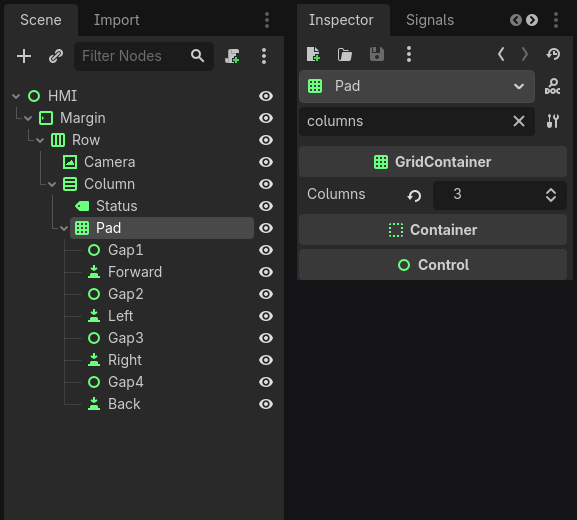

Now make the arrows big enough to hit with a thumb. :kbd:`Ctrl`-click the four buttons to
select them together, filter the Inspector for ``minimum``, and set *Custom Minimum Size* to
``90`` × ``90``. Editing several selected nodes at once changes all of them.

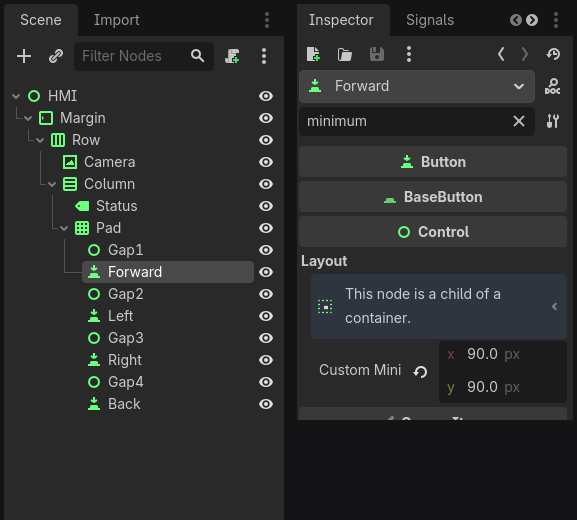

4. Speed slider and Dock button
-------------------------------

Add four more nodes to ``Column``, below ``Pad``:

.. list-table::
   :header-rows: 1
   :widths: 18 18 64

   * - Name
     - Type
     - In the Inspector
   * - ``SpeedLabel``
     - ``Label``
     - *Text*: ``Speed``
   * - ``Speed``
     - ``HSlider``
     - *Min Value* ``0.1``, *Max Value* ``0.5``, *Step* ``0.05``, *Value* ``0.3``
   * - ``Dock``
     - ``Button``
     - *Text*: ``Dock``
   * - ``Message``
     - ``Label``
     - *Horizontal Alignment*: **Center** (leave the text empty)

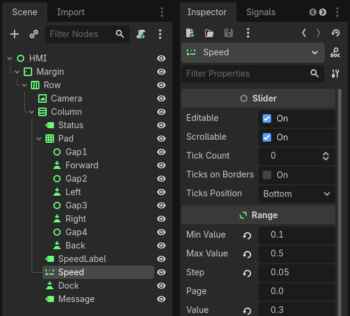

The slider is in m/s: the script reads its value as the forward speed.

5. Unique names
---------------

The script needs to reach eight of these nodes. Right-click each of ``Camera``, ``Status``,
``Forward``, ``Left``, ``Right``, ``Back``, ``Speed`` and ``Message``, and choose **Access as
Unique Name**. A **%** appears next to each one.

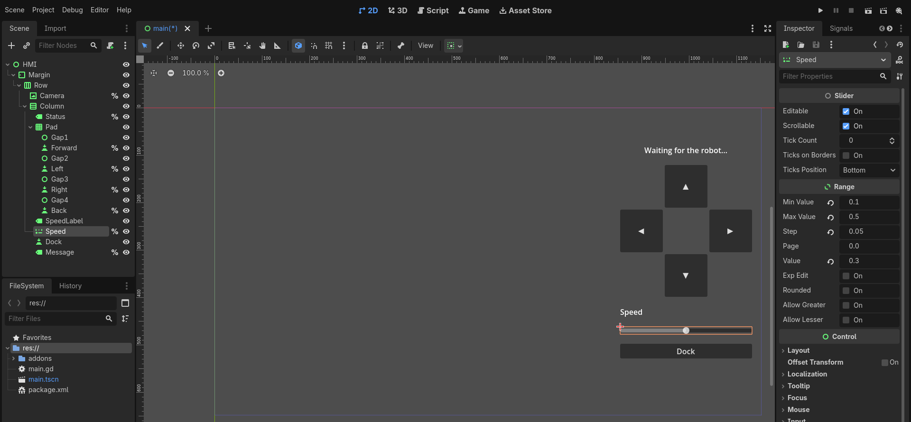

The script now finds them as ``%Status``, ``%Speed``… wherever they sit in the tree, so you
can move things around later without touching the code.

6. A theme
----------

The default text is small for a control panel. Select ``HMI``, then in the Inspector open
*Theme → Theme*, pick **New Theme**, and click the new theme to edit it. Set *Default Font
Size* to ``28``.

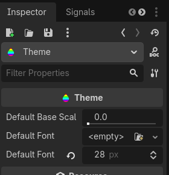

Every label, button and slider in the HMI inherits it at once. That's the point of a theme:
the look lives in one place, not on each widget. The *Theme* panel that opens at the bottom
of the editor can also restyle buttons, panels and colours.

7. Scale with the window
------------------------

Open *Project → Project Settings*, type ``stretch`` in the search box, and set *Display →
Window → Stretch → Mode* to **canvas_items**.

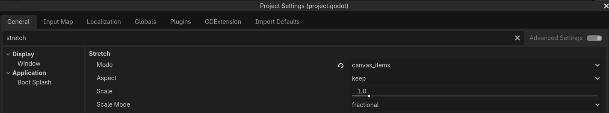

Now the whole panel scales with the window instead of staying at a fixed pixel size. Try it
when it runs: resize the window, or make it fullscreen on a touch screen.

8. The script
-------------

Double-click ``main.gd`` in the *FileSystem* dock and replace everything in it with:

.. literalinclude:: ../../src/roomba_hmi/main.gd
   :language: gdscript
   :caption: main.gd

Save it, then drag ``main.gd`` from the *FileSystem* dock onto the ``HMI`` node. A scroll
icon next to ``HMI`` shows it's attached, and the script's ``Turn Speed`` appears in the
Inspector.

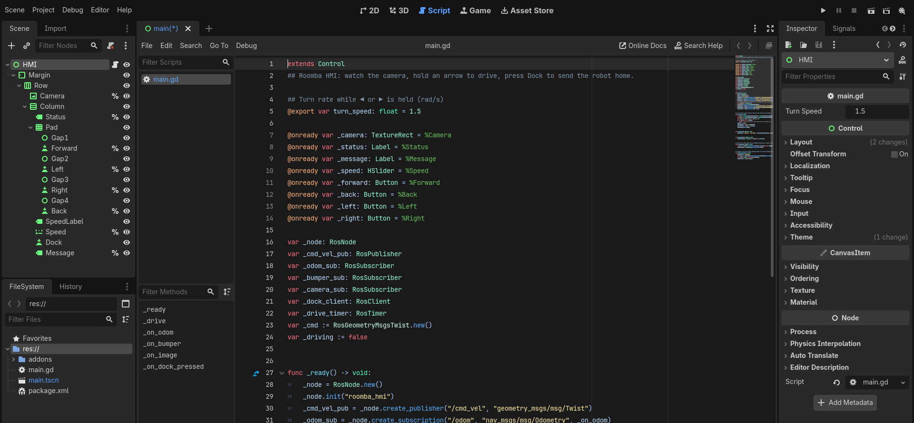

What it does, top to bottom:

``@onready var ... = %Status``
   Picks the widgets out of the scene by their unique names, once the scene is loaded.

``_ready()``
   The ROS side, as in the workshop: a node, a ``/cmd_vel`` publisher, three subscriptions
   and a timer. Also a **service client** for ``/roomba/dock``, the other end of the service
   you wrote in :doc:`06_services_params`.

``_drive()``
   Runs at 10 Hz. ``button_pressed`` is true while an arrow is held down, so holding ▲ drives
   forward at the slider's speed, and letting go sends one stop. While nothing is held it
   publishes nothing, so ``bump_and_turn.py`` or teleop can still drive the robot.

``_on_odom()``, ``_on_bumper()``
   Topic callbacks run on Godot's main thread, so they can set a label's text or colour
   directly.

``_on_image()``
   The camera publishes best effort, so its subscription uses a best-effort ``RosQoS``
   (:doc:`04_sensors`). Each image's bytes become an ``Image``, then an ``ImageTexture`` that
   the ``Camera`` node shows.

``_on_dock_pressed()``
   ``async_send_request()`` sends the request, and ``await request.completed`` waits for the
   answer *without blocking*: the camera and the buttons keep working meanwhile. Nothing calls
   this function yet. That's the next step.

9. Connect the Dock button
--------------------------

Select ``Dock``, switch the right-hand dock from *Inspector* to **Signals**, and double-click
``pressed()``. In the dialog, select ``HMI`` as the receiver. Godot proposes the method name
``_on_dock_pressed``, which matches the function in the script. Click **Connect**.

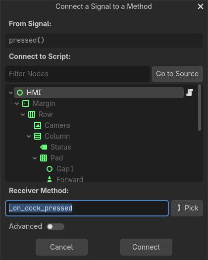

The connection shows up under ``pressed()``, and a signal icon appears next to ``Dock`` in the
*Scene* dock:

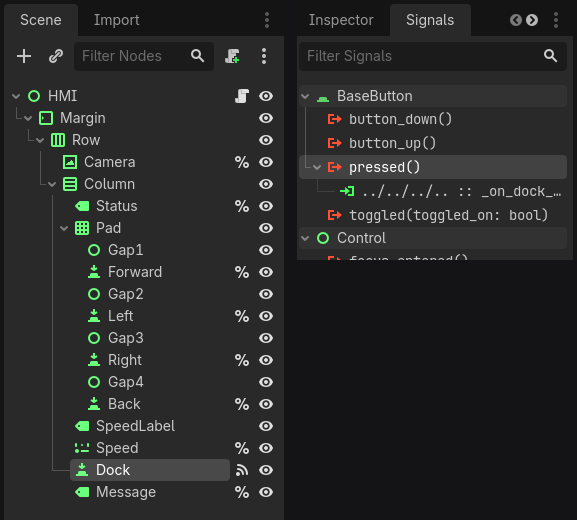

The connection is saved in ``main.tscn``, not in the code. Swap the button for another
widget, connect it, and the script doesn't change.

Check it
--------

Start the robot from a terminal, and press :kbd:`F5` in the HMI's editor:

.. code-block:: bash

   ros2 run roomba_rclgd roomba_rclgd

Put the two windows side by side: some desktops slow down a window that's completely covered.

#. **The camera** shows the robot's view, and the top line shows its speed.
#. **Hold ▲** and the robot drives forward. Hold ◀ or ▶ to turn. Move the slider and drive
   again.
#. **Drive into the sofa** and the speed line turns red while the bumper is pressed.
#. **Press Dock** and the robot jumps back to its dock. *Back on the dock* appears: that's the
   service's response message.
#. **Resize the window** and everything scales with it.

.. code-block:: console

   $ ros2 node info /roomba_hmi
   /roomba_hmi
     Subscribers:
       /bumper: std_msgs/msg/Bool
       /camera/image_raw: sensor_msgs/msg/Image
       /odom: nav_msgs/msg/Odometry
     Publishers:
       /cmd_vel: geometry_msgs/msg/Twist
     ...
     Service Clients:
       /roomba/dock: std_srvs/srv/Trigger

To ship it, ``colcon build --packages-select my_roomba_hmi`` and ``ros2 run my_roomba_hmi
my_roomba_hmi``, like any other package.

Going further
-------------

* **A touch screen:** set *Display → Window → Size → Mode* to **Fullscreen**. Godot turns
  touches into clicks, so holding an arrow with a finger drives the robot.
* **A Reset odometry button:** duplicate ``Dock``, add a client for
  ``/roomba/reset_odometry`` (``std_srvs/srv/Empty``), and connect it the same way.
* **Style it:** open the theme in the *Theme* panel and give ``Button`` a rounded
  ``StyleBoxFlat``. Every button changes at once.
